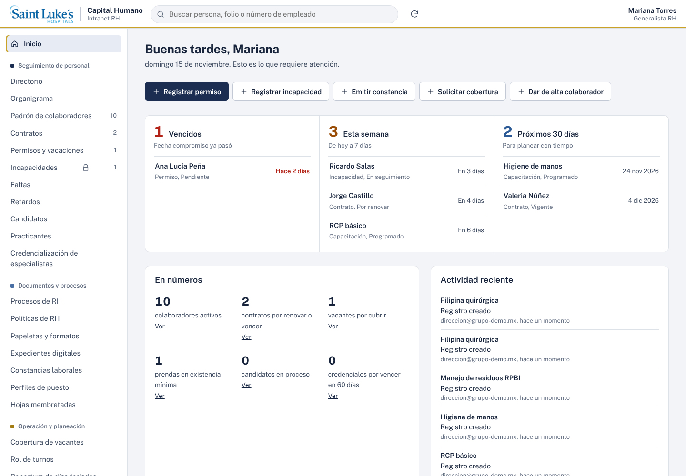
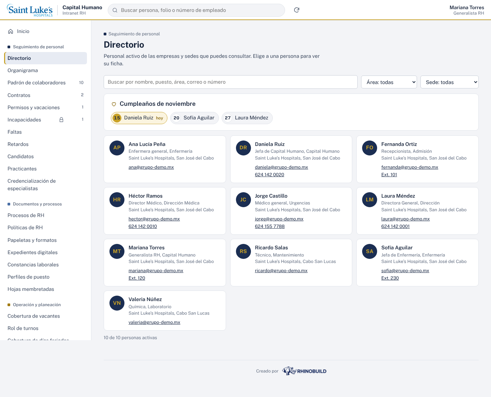
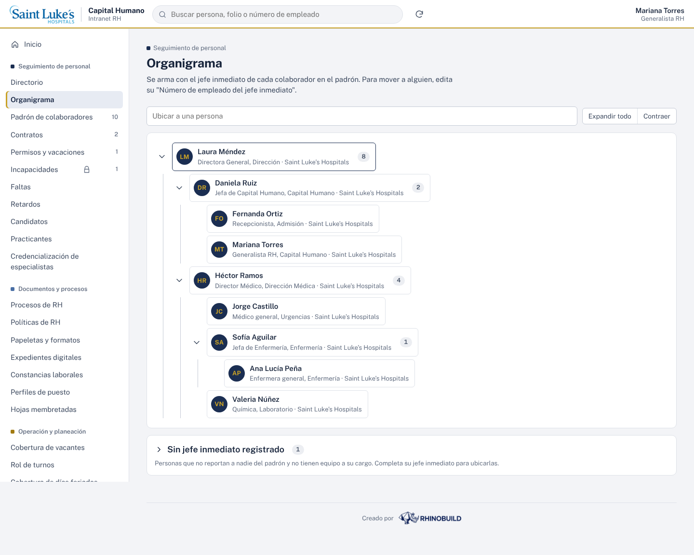

# Capital Humano · Intranet RH (Google Apps Script)

Versión de la intranet de Capital Humano construida como web app de Google Apps Script, con Google Sheets como base de datos y una carpeta privada de Drive para los archivos. Incluye los mismos módulos que la plataforma original y las mejoras de seguridad, permisos y usabilidad.



| Directorio | Organigrama |
|---|---|
|  |  |

> GitHub guarda el código; la plataforma **no se ejecuta en GitHub Pages**. Funciona como aplicación web de Google Apps Script, así que se instala en Google siguiendo los pasos de abajo.

## Estructura del repositorio

| Carpeta | Contenido |
|---|---|
| `src/` | Los archivos que van a Apps Script (`.gs`, `.html` y `appsscript.json`). |
| `pruebas/` | Simulador de Apps Script para Node.js, 84 comprobaciones y vista previa local. |
| `docs/` | Capturas. |
| `.github/workflows/` | Corre las pruebas automáticamente en cada cambio. |

## Antes de empezar

- **Usa una cuenta de Google Workspace del grupo** (no un Gmail personal) para crear y publicar el proyecto. Esa cuenta será la dueña de la hoja de cálculo y de la carpeta de archivos.
- **Todo el equipo debe entrar con cuentas del mismo dominio.** Apps Script solo informa el correo de quien entra cuando la persona y la plataforma pertenecen al mismo dominio de Workspace. Con cuentas de Gmail personales la plataforma mostrará "No pudimos identificar tu cuenta".

## Instalación (15 minutos)

1. Entra a [script.google.com](https://script.google.com) con la cuenta corporativa y crea un **proyecto nuevo**. Ponle de nombre "Capital Humano · Intranet RH".
2. En **Configuración del proyecto** (ícono de engrane), activa **Mostrar el archivo de manifiesto "appsscript.json" en el editor**.
3. En el editor, abre `appsscript.json` y reemplaza su contenido por el de `src/appsscript.json`.
4. Borra el archivo `Código.gs` y crea estos archivos con el botón **+**, usando exactamente estos nombres. El editor agrega la extensión solo.
   - **Secuencia de comandos:** `Config`, `Policy`, `Data`, `Nom035`, `Evaluations`, `Pdf`, `Api`, `Import`
   - **HTML:** `Index`, `Styles`, `Logos`, `Client`

   Pega en cada uno el contenido del archivo con el mismo nombre de la carpeta `src/`. El orden no importa.
5. Guarda. En la barra superior elige la función **instalar** y pulsa **Ejecutar**. Autoriza los permisos que pide Google (hojas de cálculo, Drive y tu correo). Se crean:
   - la hoja "Capital Humano · Base de datos (no compartir)"
   - la carpeta "Capital Humano · Adjuntos (no compartir)"
6. Pulsa **Implementar → Nueva implementación**, tipo **Aplicación web**:
   - Ejecutar como: **Yo**
   - Quién tiene acceso: **Cualquier usuario de [tu dominio]**
7. Copia la URL de la aplicación web y ábrela. Entras como titular (Dirección RH, todas las empresas y sedes).
8. En **Usuarios y permisos**, agrega al equipo con su correo corporativo, rol, empresas y sedes.
9. (Opcional) En la misma pantalla, en **Importar datos de la versión anterior**, pega el enlace de la hoja de la intranet anterior (pestañas Empleados, Solicitudes y Vacantes), elige empresa y sede por omisión y pulsa **Revisar**. Verás cuántos registros entran y los avisos; si todo está bien, pulsa **Importar**. Ver "Importación" abajo.

### Alternativa: instalar con clasp

[clasp](https://github.com/google/clasp) sube la carpeta `src/` completa sin copiar y pegar. Requiere Node.js.

```
npm install -g @google/clasp
clasp login                          # con la cuenta corporativa
git clone https://github.com/RHINOBUILD/intranet-slh.git
cd intranet-slh
clasp create --type standalone --title "Capital Humano · Intranet RH" --rootDir src
clasp push
```

Después sigue desde el paso 5 (ejecutar `instalar` e implementar). El archivo `.clasp.json` que se genera queda fuera del repositorio porque identifica tu proyecto.

## Ajustes opcionales

En **Configuración del proyecto → Propiedades de la secuencia de comandos**:

| Propiedad | Para qué sirve |
|---|---|
| `RH_OWNER_EMAILS` | Correos de las personas titulares, separados por coma. Por defecto, la cuenta que instaló. Solo un titular otorga el permiso de administrar accesos. |
| `RH_OWNER_NAME` | Nombre que se muestra para el titular, por ejemplo "Dirección de Capital Humano". |

## Reglas de seguridad importantes

- **No compartas la hoja de cálculo ni la carpeta de adjuntos con nadie.** El equipo entra solo por la URL de la aplicación, que aplica los permisos. Si compartes la hoja, quien la abra verá todo sin restricciones.
- La aplicación se ejecuta con la cuenta propietaria. Si esa cuenta se da de baja, la plataforma deja de funcionar: transfiere antes el proyecto, la hoja y la carpeta a otra cuenta corporativa.
- Respaldo: la hoja conserva su historial de versiones (Archivo → Historial de versiones). Además, conviene descargar una copia mensual.

## Actualizar la plataforma

Edita los archivos en el editor (o en `src/` y luego `clasp push`) y después **Implementar → Administrar implementaciones → editar (lápiz) → Versión: nueva versión → Implementar**. La URL no cambia.

## Permisos por rol

| Rol | Qué puede hacer |
|---|---|
| Dirección RH | Todo en su alcance, incluidos documentos comunes ("Todas las empresas"), evaluaciones e incapacidades. Única que elimina registros. |
| Jefatura RH | Todos los módulos de su alcance, incluidas evaluaciones (NOM-035) e incapacidades. Concilia inventarios. Puede recibir permiso para administrar accesos. |
| Generalista RH | Módulos de su alcance, incluidas incapacidades. No ve evaluaciones individuales. |
| Reclutamiento | Candidatos, cobertura de vacantes, perfiles de puesto y procesos. |
| Capacitación | Calendario de capacitaciones y procesos. |
| Consulta | Solo lectura y descarga. No ve salarios, fechas de nacimiento, incapacidades ni evaluaciones. |

Las sedes "Caribe", "Vallarta" y "Nayarit" agrupan otras sedes. Quien tiene la sede agrupadora ve y edita sus sedes. Quien tiene una sede miembro, como Cancún, ve sin editar lo registrado como "Caribe".

## Qué incluye respecto a la plataforma original

**Igual:** los módulos de seguimiento de personal, documentos, operación y evaluaciones; constancias y solicitudes de cobertura en PDF con hoja membretada; inventario de uniformes con entradas, salidas y conciliación; listas de verificación; evaluaciones de paramédicos, 360°, desempeño, RH y NOM-035 (guías I, II y III) con calificación automática; bitácora de cambios.

**Mejoras:**
- Directorio del personal activo con búsqueda, filtros por área, empresa y sede, enlaces de correo y teléfono, y cumpleaños del mes.
- Organigrama que se arma solo con el "Número de empleado del jefe inmediato" del padrón: niveles plegables, conteo de personas a cargo, búsqueda que ubica a la persona y lista de quienes aún no tienen jefe registrado.
- Importación de la versión anterior (empleados, solicitudes y vacantes) con revisión previa y sin duplicados.
- Identidad institucional azul marino y dorado, también en los PDF.
- Inicio organizado como agenda: vencidos, esta semana y próximos 30 días.
- Búsqueda global por nombre, folio o número de empleado.
- Al registrar permisos, incapacidades, constancias y demás, se busca a la persona en el padrón y se llenan sus datos.
- Permisos aplicados en el servidor: cada persona recibe solo los registros de su alcance, sin salarios si su rol no debe verlos.
- Administradores delegados (Dirección o Jefatura RH), limitados a su propio alcance.
- La bitácora registra qué campos cambiaron, cada descarga de archivo o PDF y quién la hizo.
- Folios automáticos para oficios (OF), constancias (CL) y coberturas (CV).
- Eliminación definitiva restringida a Dirección RH, para solicitudes ARCO de cancelación o capturas duplicadas. La bitácora conserva el evento sin datos personales.
- Exportación a CSV de cada módulo.
- Diseño adaptado a celular.
- Logotipo de Saint Luke’s Hospitals en el encabezado y crédito "Creado por RHINOBUILD" al pie de cada página. Los logotipos van incrustados en `src/Logos.html`, así que no dependen de enlaces externos.

**Cambios a considerar:**
- Los datos de la intranet anterior se traen con el importador (ver abajo). Los historiales de contratos y uniformes de los archivos anteriores no se importan.
- "911 BAYWATCH" se unificó como "911 Baywatch Ambulance", y se agregaron VIE Hospital de México, ST Josephs, Hospital Sayulita, STL Loreto, Puerto Rico CSL y Soc. Admra. y Apoyo Médico S.C. Edita `COMPANIES` en `src/Config.gs` si alguna no corresponde.
- La hoja membretada para PDF debe ser una imagen PNG o JPG tamaño carta (Apps Script no puede usar un PDF como fondo).
- Archivos de hasta 10 MB cada uno.
- Google Sheets responde bien con miles de registros. Si el volumen llega a decenas de miles, conviene migrar a una base de datos.

## Importación de la versión anterior

Solo la persona titular la ve (al final de **Usuarios y permisos**). La cuenta propietaria de la plataforma debe tener acceso a la hoja anterior.

| Pestaña anterior | Va a | Cómo se traduce |
|---|---|---|
| Empleados | Padrón de colaboradores | ID → número de empleado; Departamento → área; ReportaA → jefe inmediato; Estatus "Baja/Inactivo" → Baja. |
| Solicitudes | Permisos y vacaciones | Vacaciones se conserva; los demás tipos quedan como "Otro" con el tipo original al inicio del motivo. Aprobada → Autorizado, Rechazada → No autorizado. |
| Vacantes | Cobertura de vacantes | Plazas → cantidad; Abierta y Finalistas → En reclutamiento; Pausada → Pendiente; Cubierta → Cubierta. Reciben folio CV. |

- Los encabezados se reconocen sin importar acentos ni mayúsculas. Las fechas pueden venir como fecha de Sheets, `aaaa-mm-dd` o `dd/mm/aaaa`.
- Si la sede del archivo no existe en el catálogo (por ejemplo "Puerto Rico"), se usa la sede por omisión y aparece un aviso.
- Un número de empleado que ya existe en el padrón actual no se sobrescribe: se omite con aviso.
- Lo que falte (fecha de ingreso, tipo de relación, etc.) queda en blanco y se pide al editar el registro.
- Es repetible: cada registro guarda su origen y una segunda importación solo trae lo nuevo.

## Pruebas

La carpeta `pruebas/` contiene un simulador de los servicios de Apps Script para Node.js:

```
node pruebas/test.js src      # 84 comprobaciones de permisos, guardado, archivos, PDF, NOM-035, organigrama e importación
node pruebas/preview.js src   # vista previa local con datos ficticios en http://localhost:8765/?as=generalista@grupo-demo.mx
```

---

Creado por RHINOBUILD.
